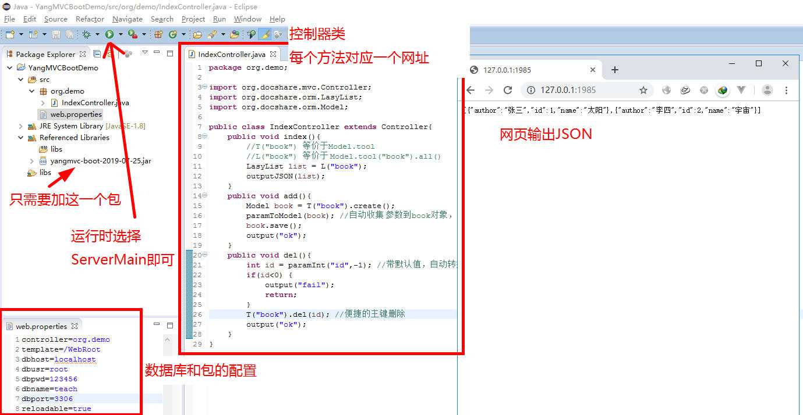

# YangMVC

一个高效、轻量级的MVC和ORM框架，提供多种部署方式和集成方案。

[](https://opensource.org/licenses/MIT)
[](https://search.maven.org/artifact/org.docshare/yangmvc)
[](https://www.oracle.com/java/)

## 🚀 项目概述

YangMVC是一个现代化的Java Web框架，采用约定优于配置的设计理念，让Web开发变得简单高效。框架提供了完整的MVC架构和强大的ORM功能，支持多种部署方式，满足不同场景的开发需求。

### 🎯 核心特性

- **🎨 约定优于配置**: IndexController对应网站根目录，BookController对应/book目录
- **🗄️ 强大的ORM**: 无需预先生成POJO类，Model类适应任何表和视图
- **⚡ 高效开发**: 一个jar包完成绝大多数Web网站开发
- **🔧 多种部署**: 支持传统Web项目、Boot独立部署、Spring Boot集成
- **📊 灵活查询**: 链式调用，支持复杂SQL和简单查询
- **🎭 模板支持**: 无缝兼容JSTL，支持FreeMarker

### 📦 项目架构

本仓库包含YangMVC框架的完整生态系统：

```
YangMVC/
├── YangMVC/           # 核心框架
├── YangMVCBoot/       # Boot版本（独立部署）
├── YangMVCSpring/     # Spring Boot集成版本
├── YangMVCDemo/       # 传统Web项目示例
└── YangMVCBootDemo/   # Boot版本示例
```

## 📋 子项目说明

| 项目 | 描述 | 适用场景 |
|------|------|----------|
| **YangMVC** | 核心框架 | 传统Web项目，需要部署到Tomcat等容器 |
| **YangMVCBoot** | Boot版本 | 独立运行，内置Jetty服务器，类似Spring Boot |
| **YangMVCSpring** | Spring集成 | 与Spring Boot项目集成，享受两个框架的优势 |
| **YangMVCDemo** | 传统示例 | 展示如何在传统Web项目中使用YangMVC |
| **YangMVCBootDemo** | Boot示例 | 展示Boot版本的使用方法 |

## 🛠️ 快速开始

### Maven依赖

根据您的需求选择合适的版本：

```xml
<!-- 核心框架（传统Web项目） -->
<dependency>
    <groupId>org.docshare</groupId>
    <artifactId>yangmvc</artifactId>
    <version>2025.06.20</version>
</dependency>

<!-- Boot版本（独立部署） -->
<dependency>
    <groupId>org.docshare</groupId>
    <artifactId>yangmvc-boot</artifactId>
    <version>2025.06.20</version>
</dependency>

<!-- Spring Boot集成版本 -->
<dependency>
    <groupId>org.docshare</groupId>
    <artifactId>yangmvc-spring</artifactId>
    <version>2025.06.20</version>
</dependency>
```

### 简单示例

```java
public class IndexController extends Controller {
    public void index() {
        // 简单的数据库查询
        LasyList list = Model.tool("book").all().gt("id", 12).lt("id", 33);
        outputJSON(list);
    }
    
    public void add() {
        Model book = Model.tool("book").create();
        paramToModel(book); // 自动收集参数到Model对象
        book.save();
        output("ok");
    }
}
```

## 🎯 ORM特性展示

YangMVC的ORM设计极其简洁，无需复杂配置：

```java
// 等价于: SELECT * FROM book WHERE id > 12 AND id < 33
LasyList list = Model.tool("book").all().gt("id", 12).lt("id", 33);

// 链式调用，支持复杂查询
LasyList books = Model.tool("book")
    .all()
    .eq("status", "published")
    .like("title", "Java")
    .orderBy("create_time",true)
    .limit(10);

// 直接执行SQL（返回LasyList而非ResultSet）
LasyList result = Model.tool("book").sql("SELECT * FROM book WHERE price > ?", 50);
```
## 🎯 应用场景

### 1. API服务开发


**移动App后端开发示例**：
```java
public class IndexController extends Controller{
    public void index(){
        //T("book") 等价于Model.tool
        //L("book") 等价于 Model.tool("book").all()
        LasyList list = L("book");
        outputJSON(list);
    }
    
    public void add(){
        Model book = T("book").create();
        paramToModel(book); //自动收集参数到book对象
        book.save();
        output("ok");
    }
    
    public void del(){
        int id = paramInt("id", -1); //带默认值，自动转换类型
        if(id < 0) {
            output("fail");
            return;
        }
        T("book").del(id); //便捷的主键删除
        output("ok");
    }
}
```

**API接口访问**：
- `http://127.0.0.1:1985/` - 获取book表JSON数据
- `http://127.0.0.1:1985/add` - 添加数据接口
- `http://127.0.0.1:1985/del?id=12` - 删除数据接口

### 2. Web应用开发

传统Web项目只需引入一个jar包：`yangmvc-版本号.jar`

在web.xml中配置数据库连接信息即可开始开发。

### 3. 集成场景
- **Spring Boot集成**: 使用YangMVCSpring版本
- **微服务架构**: Boot版本支持独立部署
- **前后端分离**: 完美支持Vue.js、React等前端框架

## 💬 社区交流

**QQ交流群**: 753780493

欢迎加入讨论技术问题、分享使用经验！

## 🚀 快速上手

### 环境要求
- **JDK**: 1.7+ 版本
- **IDE**: Eclipse、IntelliJ IDEA、MyEclipse
- **容器**: Tomcat 6.0+ (可选，Boot版本内置Jetty)

### 配置教程
- **Eclipse用户**: [Boot版本配置教程](https://gitee.com/yangtf/YangMVC/wikis/A01-%E9%85%8D%E7%BD%AE-boot%E7%89%88)
- **MyEclipse用户**: [传统版本配置教程](https://gitee.com/yangtf/YangMVC/wikis/A01-%E9%85%8D%E7%BD%AE)

## 📋 版本更新

### 2025.06.20 (当前版本)
- 完善Spring Boot集成支持
- 优化Boot版本性能和稳定性
- 增强文档和示例代码

### 2018-6-5
**版本命名规则更新**: 采用日期命名
- `yangmvc-2018-6-5.jar` (核心版本)
- `yangmvc-boot-2018-6-5.jar` (Boot版本)

**新增POJO生成功能**:
```bash
java -jar yangmvc-2018-6-5.jar
```
按提示输入数据库信息和包名，自动生成实体类到指定目录。

### V2.3.6
- **兼容性提升**: 修复Tomcat 6.0文件上传问题
- **API优化**: 移除高版本Servlet-API依赖

### V2.3.5
- **灵活性增强**: 支持关键字作为表名和字段名
- **便捷方法**: Model类新增getStr/getInt/getLong方法

### V2.0
- **性能优化**: 增加gzip传输压缩
- **稳定性**: 修复已知问题

## 📚 文档资源

### 完整文档
[YangMVC Wiki文档](https://gitee.com/yangtf/YangMVC/wikis/pages)

### API文档
[Javadoc在线文档](http://yangtf.gitee.io/yangmvc/YangMVC/doc/index.html)

### 核心类参考
掌握这三个核心类，即可熟练使用框架：

- **[Controller](http://yangtf.gitee.io/yangmvc/YangMVC/doc/org/docshare/mvc/Controller.html)** - MVC控制器基类
- **[DBTool](http://yangtf.gitee.io/yangmvc/YangMVC/doc/org/docshare/orm/DBTool.html)** - 数据库操作工具
- **[LasyList](http://yangtf.gitee.io/yangmvc/YangMVC/doc/index.html)** - 延迟加载列表


